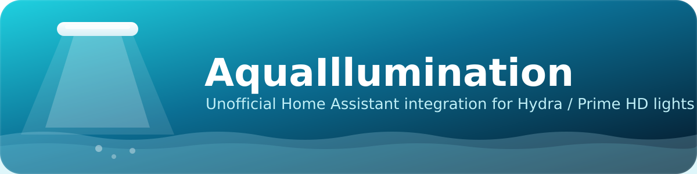

# AquaIllumination Home Assistant integration (Hydra 52 HD)

A small, self-contained Home Assistant custom integration for controlling
AquaIllumination Hydra/Prime HD lights (built and tested for a trio of
Hydra 52 HDs) individually, channel by channel, from Home Assistant.

**Important context:**
- AquaIllumination has never published an API. This talks to the same
  undocumented local HTTP API the myAI app uses, as reverse engineered by
  the reef-keeping community. A firmware update could change or break it
  at any time.
- This has **no external pip dependency** - it only uses `aiohttp`, which
  Home Assistant already ships. That avoids a real problem with the
  existing community integration this was based on (its manifest pulls a
  library straight from a GitHub `git+` URL, which is fragile to install
  and has an open "broken" issue as of this writing).
- It's a straight HTTP control channel - it does not touch or replace the
  on-device schedule/presets you build in the myAI app. Those keep running
  exactly as they do today.
- **Update:** some firmware locks the control endpoints behind the
  password you set for the fixture (the same one its own web page at
  `http://<ip>/login.html` asks for). This version logs in with that
  password automatically before talking to the light - see "Password"
  below.

## What you get

For each fixture you add:

- One Home Assistant light entity **per color channel** the fixture
  reports (e.g. Cool White, Royal Blue, Deep Red, Green, Violet -
  whatever your Hydra 52 HD actually returns).
- One **light** entity, `"<fixture> Overall"` - a single 0-100% control
  that sets *every* channel on that fixture to the same flat value in one
  move. It shows up right alongside the channel lights under the same
  device (Settings > Devices & Services > AquaIllumination > that
  fixture). Its brightness is independent and persisted - it remembers
  whatever you last set it to across restarts, and does not silently
  change just because you nudge an individual channel by hand elsewhere.
  (Want it to scale the current mix proportionally instead of flattening
  it - i.e. a "master dimmer" that preserves the ratio between channels -
  rather than setting every channel equal? That's a reasonable follow-up
  and not hard to add; just ask.)
- One switch entity to toggle that fixture's on-device schedule on/off if
  you ever want to.

Example, after adding all three lights:

```
light.sump_light_1_cool_white
light.sump_light_1_royal_blue
light.sump_light_1_deep_red
...
light.sump_light_2_cool_white
...
light.sump_light_3_cool_white
...
light.sump_light_1_overall
light.sump_light_2_overall
light.sump_light_3_overall
switch.sump_light_1_schedule
switch.sump_light_2_schedule
switch.sump_light_3_schedule
```

(The exact channel names depend on what your fixture's firmware reports -
check Developer Tools > States after setup to see the real list.)

## ⚠️ About the on-device schedule (read this first)

Per your setup: you're keeping each light's own schedule running for your
day/night ramp, and using Home Assistant for occasional manual overrides
on top of it. Be aware that **while a fixture's schedule is enabled, a
brightness change from Home Assistant (or the app, or anything else) is
typically only temporary** - the light re-asserts its own scheduled levels
within seconds to a couple of minutes, depending on firmware. So:

- Good fits: momentary looks/checks, quick "what does 100% cool white
  look like", triggering a brief "feed mode" scene, dashboard status/
  monitoring.
- Not a good fit as-is: an automation meant to *hold* a level (e.g. "keep
  all lights at 20% blue after 10pm") - that will get overwritten by the
  schedule almost immediately.
- If you want a change to stick, either build that specific behavior into
  the fixture's own schedule/presets in the app, or flip that fixture's
  `switch.<name>_schedule` off first so nothing is fighting your Home
  Assistant command, then remember to turn it back on afterward (or
  automate that pairing).

## Password

Find the password by opening `http://<light-ip>/login.html` in a browser
for each fixture - whatever unlocks that page is what you enter in the
integration's setup form. If a fixture was never given a password there
(no login page appears, `/api/colors` just answers directly), leave the
field blank... but the myAI app has each fixture password-protected by
default, so most people will have one to enter.

## Installation (manual copy - no HACS needed)

1. Get the `custom_components/aquaillumination` folder onto your Home
   Assistant machine, inside your config directory, so you end up with:
   `/config/custom_components/aquaillumination/...`
   The easiest ways to do that on Home Assistant OS/Supervised:
   - Install the **Samba share** or **Studio Code Server** / **File
     editor** add-on (Settings > Add-ons > Add-on Store), then copy the
     folder in.
   - Or use the **SSH & Web Terminal** add-on and `scp`/`curl` it in.
2. Restart Home Assistant (Settings > System > Restart) - **required again
   any time you replace these files with an updated version**, including
   this one if you'd already installed an earlier copy.
3. Go to **Settings > Devices & Services > + Add Integration**, search for
   **"AquaIllumination"**, and add it.
4. Enter the IP address of your first Hydra 52 HD (find it in the myAI app
   under that light's Wi-Fi/network settings, or check your router's
   client list), a name (e.g. "Sump Light 1"), and its password (see
   above).
5. Repeat step 3-4 two more times for your other two lights, each with its
   own IP, name, and password.
6. Check Settings > Devices & Services > AquaIllumination - you should see
   three devices, each with its channel-brightness lights and a schedule
   switch.

If you already added a light with an earlier version of this integration
before the password field existed, remove that entry (Settings > Devices
& Services > AquaIllumination > that device > Delete) and add it again
with the updated files in place, so it prompts for the password.

**If you're updating from a version that had a `number.<fixture>_overall`
entity:** that entity moved to `light.<fixture>_overall` in this version
(no need to remove/re-add the integration for this one - just restart
Home Assistant and the new light entity appears). The old `number.*`
entity will show as unavailable; delete it from Settings > Devices &
Services > Entities (search "overall", select it, Delete) to tidy up, and
update any dashboard cards or scenes/groups that referenced it to point
at the new `light.*` entity instead.

If a light fails to add with "Could not connect": double check the IP
(it can change if your router doesn't reserve it - consider a DHCP
reservation for each light), confirm Home Assistant and the lights are on
the same network/VLAN, and confirm the light is reachable at all by
opening `http://<light-ip>/` in a browser. If it fails with a password
error instead, re-check it directly against `http://<light-ip>/login.html`
- it's case-sensitive and there's no separate username.

## Individual control

Each channel is just a normal Home Assistant light entity with a
brightness slider (0-100%, shown as 0-255 internally like any HA light).
Add them to a dashboard, script them, automate them - anything you'd
normally do with a light entity.

## Presets & synced groups

Everything in this section is a built-in Home Assistant feature, not
custom code - so it's all created, renamed, and edited entirely from
**Settings** in the Home Assistant UI, no YAML or file edits required
(YAML equivalents are included below for reference, if you'd rather
version-control your groups/scenes that way instead).

### Per-channel groups (e.g. "Cool White" across all three lights, one slider)

A **Light Group** helper combines the matching channel entity from each
fixture into one slider:

1. Go to **Settings > Devices & Services > Helpers tab > + Create
   Helper**.
2. Choose **Light Group**.
3. Name it, e.g. "All Lights - Cool White".
4. In the entity picker, select the three matching channel entities, one
   from each fixture - e.g. `light.left_cool_white`,
   `light.center_cool_white`, `light.right_cool_white`.
5. Save. You now have a `light.all_lights_cool_white` entity: turning it
   on/off or moving its brightness slider sends that same brightness to
   all three fixtures' Cool White channel simultaneously, while each
   fixture's individual Cool White entity still works on its own too.

Repeat for any other channel you want a synced group for (Royal Blue,
Deep Red, etc.) - each is its own separate helper with independent
percentage control. To edit or delete one later: Settings > Devices &
Services > Helpers tab > click it.

YAML equivalent, if you prefer that:

```yaml
light:
  - platform: group
    name: "All Lights - Cool White"
    entities:
      - light.left_cool_white
      - light.center_cool_white
      - light.right_cool_white
```

### Full presets (e.g. "Aquarium Cleaning" - 85% on every channel, all three lights, one tap)

For a preset that sets a specific combination across everything at once -
not just one channel - use a Home Assistant **Scene**. A scene captures
an exact target state for a list of entities and applies all of them
together the moment you activate it.

To build your cleaning-day preset:

1. Go to **Settings > Automations & Scenes > Scenes tab > + Add Scene**.
2. Name it, e.g. "Aquarium Cleaning".
3. Click **Add entity** and add each fixture's `light.<fixture>_overall`
   entity (the three "Overall" lights from this integration) - three
   entities total for your three Hydra 52 HDs.
4. For each one, set it to **On** at **85%** brightness (the scene editor
   applies the live state to the light as you edit, so you'll see it
   actually happen on your tank as you set each one - that's normal).
5. Save. You now have `scene.aquarium_cleaning`. Activating it (tap it on
   a dashboard, call it from an automation, or trigger it via voice/
   shortcut) instantly sets all three fixtures to 85% across every
   channel, in one action.

Add it to a dashboard as a one-tap button: edit a dashboard, **+ Add
Card > Scene** (or a **Button** card targeting the scene entity), pick
`scene.aquarium_cleaning`.

You can build as many other scenes as you like the same way - e.g. an
"All Off" scene, a "Royal Blue Only" scene (each fixture's individual
Royal Blue channel on at 100%, every other channel off), a "Feed Mode",
etc. Scenes only capture entities you explicitly add, so a scene built
from channel entities can target specific colors instead of the flat
Overall control if that's what a given preset needs.

Since your on-device schedule normally drives day-to-day lighting,
remember the [schedule caveat above](#-about-the-on-device-schedule-read-this-first):
activating a scene while a fixture's schedule is enabled will typically
only hold for a few seconds to a couple of minutes before the schedule
reasserts itself. For "Aquarium Cleaning" that's probably fine since
cleaning is a short, attended task - but if you want it to hold for the
whole cleaning session, flip that fixture's `switch.<name>_schedule` off
first (you could even build a second scene, or an automation, that turns
all three schedule switches off, waits, then activates "Aquarium
Cleaning").

YAML equivalent for the scene, if you prefer that:

```yaml
scene:
  - name: "Aquarium Cleaning"
    entities:
      light.left_overall:
        state: "on"
        brightness: 217   # 85% of 255
      light.center_overall:
        state: "on"
        brightness: 217
      light.right_overall:
        state: "on"
        brightness: 217
```

## Files in this repository

```
custom_components/aquaillumination/
├── __init__.py           # sets up the config entry + polling coordinator
├── aqua_client.py         # the actual HTTP calls to the light's local API
├── config_flow.py         # the "Add Integration" UI form
├── const.py
├── light.py                # per-channel lights + the "Overall" light
├── switch.py                # per-fixture on-device-schedule toggle
├── manifest.json
├── strings.json              # UI text for the config flow
├── translations/en.json
├── icon.png / icon@2x.png     # see "Branding" below
└── logo.png
assets/branding/                 # source artwork - see "Branding" below
.github/workflows/validate.yml   # CI: hassfest + HACS structure checks
hacs.json                          # lets this be added as a HACS custom repo
LICENSE
```

Groups, scenes, and dashboards aren't in this repo - they're Home
Assistant UI configuration (Helpers / Scenes), not integration code, so
they live in your own Home Assistant instance. See "Presets & synced
groups" above.

## Uninstalling / troubleshooting

- To remove a light, delete its entry under Settings > Devices & Services
  > AquaIllumination.
- To remove the integration entirely, delete the entries above, restart
  Home Assistant, then delete the
  `custom_components/aquaillumination` folder.
- Home Assistant logs (Settings > System > Logs, or `home-assistant.log`)
  will show `aquaillumination` errors if a light stops responding -
  usually a changed IP address or the light being power-cycled.

## Branding


Original artwork (not AquaIllumination's actual branding - this is an
unofficial project) lives under `assets/branding/`:

```
assets/branding/
├── icon.svg / icon.png / icon@2x.png     # square mark, 256px / 512px
├── logo.svg / logo.png / logo@2x.png     # horizontal lockup, for READMEs etc.
└── banner.svg / banner.png / banner@2x.png  # wide hero banner (top of this file)
```

The `.svg` files are the source - edit those and re-render if you want to
tweak colors or layout (any SVG-to-PNG tool works; sizes used here are
256/512 for the icon and matching 2x variants for the others). `icon.png`
and `icon@2x.png` are also copied into `custom_components/aquaillumination/`
since that's the size/format [home-assistant/brands](https://github.com/home-assistant/brands)
expects if you ever want this integration's icon to show up in Home
Assistant's own "Add Integration" picker - that requires a separate pull
request to that repository (not this one) following their contribution
guide; it's optional and not needed for the integration to work.

## Contributing / license

MIT licensed - see `LICENSE`. Issues and pull requests welcome once this
is up on GitHub. Since this talks to an undocumented API, the most useful
contributions are usually: confirming behavior on other fixtures (Prime
HD, Hydra 26/64HD, paired lights), and flagging firmware versions where
something in `aqua_client.py` stops matching reality.
